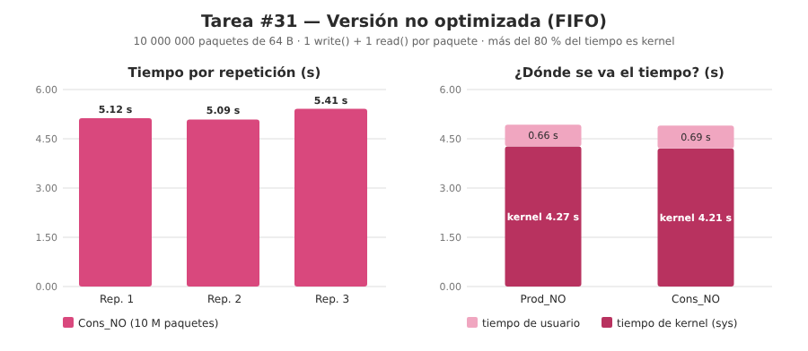
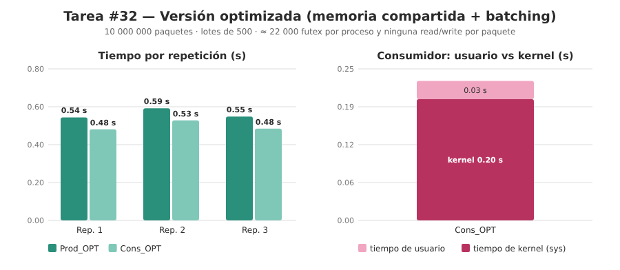
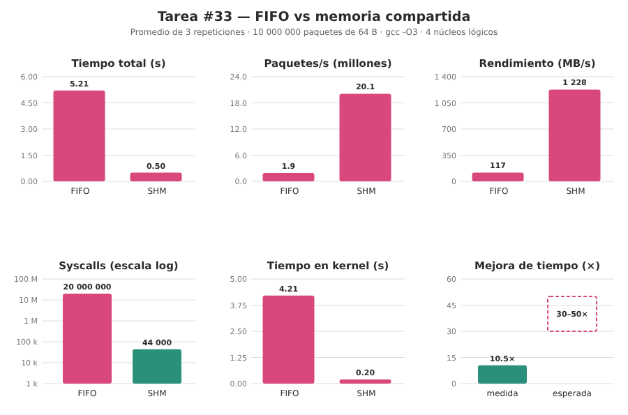
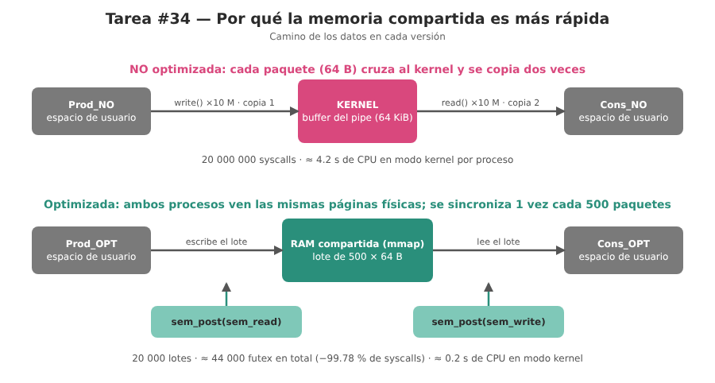

# Clase 13 — Optimización de buses de comunicación e IPC en Linux

**Fecha:** 21/10/2026
**Tareas:**

- [#31 — Non-optimized producer/consumer over a named pipe (FIFO): `Prod_NO` and `Cons_NO`](https://github.com/Luugallego17/Arquitectura-De-Computadoras-/issues/31)
- [#32 — Optimized producer/consumer with POSIX shared memory, semaphores and batching: `Prod_OPT` and `Cons_OPT`](https://github.com/Luugallego17/Arquitectura-De-Computadoras-/issues/32)
- [#33 — Run both tests and compare time, PPS, MB/s and syscall count (FIFO vs shared memory)](https://github.com/Luugallego17/Arquitectura-De-Computadoras-/issues/33)
- [#34 — Technical explanation: context switches, zero-copy and batching, with the `Clase_13` README](https://github.com/Luugallego17/Arquitectura-De-Computadoras-/issues/34)

Práctico *Optimización de Buses de Comunicación e IPC en Linux*:

> Implementar un patrón **Productor–Consumidor** que procese 10 000 000 de
> paquetes de 64 bytes para comparar el impacto del *overhead* de las
> llamadas al sistema (syscalls) y de las copias de memoria entre el
> espacio de usuario y el espacio del kernel. Ambos enfoques realizan
> exactamente la misma tarea, para que las métricas sean comparables.

## Contenido de la carpeta

| Archivo | Descripción |
|---------|-------------|
| [`Prod_NO.c`](Prod_NO.c) · [`Cons_NO.c`](Cons_NO.c) | Tarea #31. Versión **no optimizada**: *Named Pipe* (FIFO) en `/tmp/bus_fifo_no_opt`, un `write()` y un `read()` por cada paquete (10 M + 10 M de syscalls). |
| [`Prod_OPT.c`](Prod_OPT.c) · [`Cons_OPT.c`](Cons_OPT.c) | Tarea #32. Versión **optimizada**: memoria compartida POSIX (`shm_open` + `mmap`), semáforos POSIX entre procesos y *batching* de 500 paquetes por señal. |
| [`ejecutar_pruebas.sh`](ejecutar_pruebas.sh) | Tarea #33. Compila los cuatro programas y corre las dos pruebas en el orden correcto, las veces que se indique (`bash ejecutar_pruebas.sh 3`). |

El paquete es el mismo en las dos versiones: 64 bytes exactos.

```c
typedef struct {
    int  id;                              //  4 bytes
    char payload[PKT_SIZE - sizeof(int)]; // 60 bytes
} Packet;                                 // 64 bytes = una línea de caché
```

## Conceptos

- **Syscall.** Una función que el programa le pide al kernel (`read`,
  `write`, `futex`...). Cada una cambia de **modo usuario** a **modo
  kernel** y vuelve: guarda registros, cambia de nivel de privilegio,
  valida argumentos y, en un pipe, **copia** los datos entre la memoria
  del proceso y un buffer del kernel. Con paquetes de 64 bytes el trabajo
  útil es mínimo y el costo fijo de la syscall domina.
- **Named Pipe (FIFO).** Un archivo especial (`mkfifo`) que representa un
  buffer en el kernel (64 KiB por defecto en Linux). El productor copia
  sus datos *al* kernel con `write` y el consumidor los copia *desde* el
  kernel con `read`: **dos copias por paquete** y dos syscalls.
- **Memoria compartida POSIX + `mmap`.** `shm_open` crea un objeto en
  `/dev/shm` y `mmap` lo mapea en el espacio virtual de cada proceso.
  Las dos direcciones virtuales apuntan a las **mismas páginas físicas**,
  así que el productor escribe en las celdas que el consumidor lee, sin
  que el kernel copie nada (*zero-copy*).
- **Semáforo POSIX compartido.** `sem_init(&sem, 1, valor)` (`pshared = 1`)
  deja el semáforo dentro de la memoria compartida para que lo usen dos
  procesos. `sem_wait`/`sem_post` se resuelven en espacio de usuario con
  operaciones atómicas; solo cuando hay que **bloquearse o despertar** al
  otro proceso se llama a `futex()`.
- **Batching.** Agrupar 500 paquetes (32 000 bytes) por cada
  `sem_post`/`sem_wait`: se sincroniza una vez por lote y no una vez por
  paquete.

## Cómo funciona cada versión

### No optimizada (FIFO)

```
Prod_NO                                   Cons_NO
mkfifo, open(O_WRONLY)  ──── FIFO ────►   mkfifo, open(O_RDONLY)
repetir 10 000 000 veces:                 mientras recibidos < 10 000 000:
    pkt.id = i                                read(fd, &pkt, 64)   ← 1 syscall
    write(fd, &pkt, 64)  ← 1 syscall          recibidos++
close(fd)                                 close(fd), unlink(FIFO)
```

Cada `write` de 64 bytes es atómico (≤ `PIPE_BUF` = 4096), por eso el
consumidor siempre lee paquetes completos.

### Optimizada (memoria compartida + semáforos + batching)

```
Prod_OPT                                  Cons_OPT
shm_open(O_CREAT), ftruncate, mmap        shm_open, mmap
sem_init(sem_read = 0)                    (usa los semáforos del productor)
sem_init(sem_write = 1)
repetir 20 000 lotes:                     repetir 20 000 lotes:
    sem_wait(sem_write)                       sem_wait(sem_read)
    llenar 500 paquetes en la SHM             leer el lote desde la SHM
    sem_post(sem_read)  ──────────────►       sem_post(sem_write)
munmap, close                             sem_destroy ×2, munmap, shm_unlink
```

`sem_write` (valor 1) significa "el lote está libre, el productor puede
llenarlo" y `sem_read` (valor 0) significa "hay un lote listo para leer".

## Cómo compilar y ejecutar

Compilación (con `-O3`; la versión optimizada enlaza las librerías POSIX):

```bash
gcc -O3 Prod_NO.c  -o Prod_NO
gcc -O3 Cons_NO.c  -o Cons_NO

gcc -O3 Prod_OPT.c -o Prod_OPT -lrt -lpthread
gcc -O3 Cons_OPT.c -o Cons_OPT -lrt -lpthread
```

Las cuatro compilan **sin advertencias** con `-Wall -Wextra`.

Pruebas:

```bash
# Prueba 1: versión NO optimizada
./Cons_NO & ./Prod_NO

# Prueba 2: versión optimizada
./Prod_OPT & ./Cons_OPT
```

> ⚠️ En la prueba 2, si `Cons_OPT` arranca antes de que `Prod_OPT` haya
> creado la memoria compartida, falla con *"Error abriendo memoria
> compartida"*. Por eso `ejecutar_pruebas.sh` lanza primero al productor,
> espera a que exista `/dev/shm/bus_shm_opt` y recién entonces lanza al
> consumidor. Si una corrida queda trabada (por ejemplo, se cortó una de
> las dos puntas), se limpia con `pkill Prod_OPT; pkill Cons_OPT;
> rm -f /dev/shm/bus_shm_opt /tmp/bus_fifo_no_opt`.

Todo junto, con 3 repeticiones:

```bash
bash ejecutar_pruebas.sh 3
```

## Resultados medidos (tarea #33)

Equipo: Linux (kernel 6.18), 4 núcleos lógicos, `gcc -O3`. Tres
repeticiones de cada prueba. El tiempo de cada programa es el que
imprime él mismo con `clock_gettime(CLOCK_MONOTONIC)`.

### Salida de una corrida (repetición 1)

```
---- Prueba 1: NO optimizada (FIFO) ----
=== METRICAS PRODUCTOR NO OPTIMIZADO (Prod_NO) ===
Paquetes enviados : 10000000
Tiempo total     : 5.1248 segundos
Velocidad (PPS) : 1951292 paquetes/seg
Rendimiento      : 119.10 MB/s

=== METRICAS CONSUMIDOR NO OPTIMIZADO (Cons_NO) ===
Paquetes recibidos: 10000000
Tiempo total     : 5.1250 segundos
Velocidad (PPS) : 1951220 paquetes/seg
Rendimiento      : 119.09 MB/s

---- Prueba 2: OPTIMIZADA (memoria compartida + batching) ----
=== METRICAS PRODUCTOR OPTIMIZADO (Prod_OPT) ===
Paquetes enviados : 10000000
Tiempo total     : 0.5440 segundos
Velocidad (PPS) : 18381601 paquetes/seg
Rendimiento      : 1121.92 MB/s

=== METRICAS CONSUMIDOR OPTIMIZADO (Cons_OPT) ===
Paquetes recibidos: 10000000
Tiempo total     : 0.4808 segundos
Velocidad (PPS) : 20797094 paquetes/seg
Rendimiento      : 1269.35 MB/s
```

### Las tres repeticiones (lado consumidor)

| Repetición | NO opt.: tiempo | PPS | MB/s | OPT: tiempo | PPS | MB/s |
|:---:|:---:|:---:|:---:|:---:|:---:|:---:|
| 1 | 5.125 s | 1 951 220 | 119.09 | 0.481 s | 20 797 094 | 1 269.35 |
| 2 | 5.089 s | 1 965 052 | 119.94 | 0.528 s | 18 953 338 | 1 156.82 |
| 3 | 5.412 s | 1 847 805 | 112.78 | 0.485 s | 20 607 031 | 1 257.75 |
| **Promedio** | **5.21 s** | **1 921 359** | **117.27** | **0.498 s** | **20 119 154** | **1 227.97** |

### Comparación con lo esperado por el práctico

| Métrica | NO optimizado (FIFO) | OPTIMIZADO (SHM) | Mejora medida | Esperado en el práctico |
|---------|:---:|:---:|:---:|:---:|
| Tiempo de procesamiento | 5.21 s | 0.50 s | **≈ 10.5× más rápido** | ~30× a 50× (8–15 s vs 0.15–0.40 s) |
| Paquetes por segundo (PPS) | ≈ 1.9 M | ≈ 20.1 M | **≈ 10.5×** | 0.8–1.2 M vs 25–50 M |
| Rendimiento | ≈ 117 MB/s | ≈ 1 228 MB/s | **≈ 10.5×** | 50–80 vs 1 500–3 000 MB/s |
| Syscalls | 20 000 000 | ≈ 44 000 | **−99.8 %** | 20 000 000 vs 40 000 (−99.8 %) |

La versión optimizada es **un orden de magnitud más rápida** y la
reducción de syscalls coincide con la esperada, pero **este equipo no
llega a 30×–50×**: la FIFO aquí ya es más rápida que el rango esperado
(1.9 M PPS contra 0.8–1.2 M, el kernel 6.x tiene un camino de pipes
más barato) y la versión optimizada queda por debajo de los 25 M PPS
(motivos en [Límites del diseño](#límites-del-diseño-observados-al-probar)).

### Syscalls reales: `strace -c`

**FIFO** (`strace -c` con 200 000 paquetes para que termine en segundos; el
número de syscalls es exactamente uno por paquete, así que con 10 M se
extrapola linealmente):

```
$ strace -c ./Prod_NO          $ strace -c ./Cons_NO
 100.00   200001  write         99.99   200001  read
```

→ 200 001 `write` + 200 001 `read` por cada 200 000 paquetes
(1 por paquete + el `write` de `printf`/`read` de inicio) ⇒ **20 000 000
syscalls** para los 10 M de paquetes.

**Optimizada** (10 M paquetes completos, `strace -f -c`):

```
Prod_OPT                                  Cons_OPT
% time  calls  errors syscall            % time  calls  errors syscall
 99.97  21974   8788  futex               99.92  21973   9716  futex
  0.02      2         munmap               0.05      2         munmap
  0.00      9         mmap                 0.01      1         unlink
```

→ **≈ 22 000 `futex` por proceso, ≈ 44 000 en total**, y **ninguna
`read`/`write` por paquete**. 44 000 / 20 000 000 = 0.22 % ⇒ reducción
del **99.78 % ≈ 99.8 %**. Los `futex` ocurren solo cuando un proceso se
queda esperando al otro (los `errors` son `EAGAIN` de la espera); los
20 000 lotes × 2 semáforos darían como máximo ~40 000 si siempre hubiera
que bloquearse, que es el número del práctico.

### Cambios de contexto y tiempo de CPU (`getrusage`)

| Proceso | Cambios de contexto voluntarios | Tiempo usuario | Tiempo **kernel** (sys) |
|---------|:---:|:---:|:---:|
| `Prod_NO` | 5 084 | 0.66 s | **4.27 s** |
| `Cons_NO` | 6 256 | 0.69 s | **4.21 s** |
| `Cons_OPT` | 19 763 | 0.03 s | **0.20 s** |

El dato clave es la última columna: en la FIFO, **cada proceso pasa
≈ 4.2 s dentro del kernel** (más del 80 % de sus 5.2 s); en la versión
optimizada el consumidor pasa 0.20 s. Los cambios de contexto voluntarios
son *más* en la optimizada (el consumidor se duerme una vez por lote
porque el productor no se adelanta), pero cada uno ocurre por **500
paquetes** y no por 64 bytes.

### Evidencias

Las salidas originales de las pruebas están sin editar en [`evidencias/`](evidencias/):

| Archivo | Contenido |
|---------|-----------|
| [`00_entorno.txt`](evidencias/00_entorno.txt) | Kernel, compilador, CPU y RAM del equipo de prueba. |
| [`01_ejecucion_3_repeticiones.txt`](evidencias/01_ejecucion_3_repeticiones.txt) | Salida completa de `bash ejecutar_pruebas.sh 3`: compilación y las tres repeticiones de ambas pruebas. |
| [`02_strace_fifo.txt`](evidencias/02_strace_fifo.txt) | `strace -c` de la FIFO (muestra de 200 000 paquetes): una syscall por paquete. |
| [`03_strace_shm.txt`](evidencias/03_strace_shm.txt) | `strace -f -c` de la versión optimizada con los 10 M de paquetes (≈ 22 000 `futex` por proceso). |
| [`04_getrusage.txt`](evidencias/04_getrusage.txt) | Cambios de contexto y tiempo de usuario/kernel de `Prod_NO`, `Cons_NO` y `Cons_OPT`. |
| [`05_compilacion.txt`](evidencias/05_compilacion.txt) | Compilación de los cuatro programas con `-Wall -Wextra -O3`, sin advertencias. |

Capturas de terminal de esas salidas: [`evidencias/capturas/`](evidencias/capturas/).

### Gráficos

| Tarea | Gráfico |
|-------|---------|
| #31 FIFO |  |
| #32 Memoria compartida |  |
| #33 Comparación |  |
| #34 Mecanismo |  |

Se regeneran con `python3 graficos/generar_graficos.py` (produce los SVG con los valores medidos; los PNG se obtienen abriéndolos con Chromium en modo *headless*).

## Explicación del fenómeno

1. **Cambios de contexto usuario ↔ kernel.** En la FIFO, cada paquete de
   64 bytes obliga a entrar al kernel dos veces (una `write`, una
   `read`), validar el descriptor, tomar el *lock* del pipe, copiar 64
   bytes y salir. Las mediciones lo muestran: más del 80 % del tiempo de
   cada proceso es tiempo de **sistema** (4.2 s de 5.2 s), no
   procesamiento del paquete (0.7 s de usuario). El trabajo útil
   —mover 64 bytes— es mucho más barato que la entrada al kernel.
2. **Copia cero (*zero-copy*).** Con `mmap`, las dos direcciones
   virtuales apuntan a las mismas páginas físicas. El productor escribe
   directo en las celdas que el consumidor lee: no hay buffer
   intermedio del kernel ni las dos copias `usuario→kernel→usuario` de
   la FIFO. El tráfico por paquete baja a una escritura y una lectura en
   RAM/caché.
3. **Batching.** Sincronizar por lote de 500 paquetes convierte 10 M de
   sincronizaciones en 20 000. El costo fijo de la sincronización se
   reparte entre 500 paquetes (32 000 bytes ≈ 500 líneas de caché
   consecutivas, ideales para el prefetch de hardware), y el
   consumidor puede leer el lote completo sin ninguna llamada
   intermedia.

## Límites del diseño (observados al probar)

Al correr y leer el código aparecieron varias cosas que conviene dejar
escritas; el código se dejó **tal como lo pide el práctico** para que las
métricas sean comparables.

- **No es realmente un *ring buffer*.** La estructura `SharedBusBuffer`
  tiene un único lote (`batch[500]`) y dos semáforos, así que productor
  y consumidor **se alternan estrictamente**: mientras uno trabaja, el
  otro espera. Un ring buffer de varios lotes permitiría que trabajen a
  la vez; es la razón principal de que aquí se obtengan ~10× y no 30–50×.
- **"Zero-copy" parcial.** No hay copias entre procesos, pero el
  productor sigue escribiendo cada paquete (`memset` de 60 bytes +
  `id`) en la memoria compartida: son 640 MB escritos en total. Y el
  consumidor **no lee el contenido**: solo suma `BATCH_SIZE` al
  contador, por lo que no verifica que los datos lleguen correctos. La
  FIFO sí transporta y copia todos los bytes, de modo que la comparación
  favorece un poco a la versión optimizada.
- **El tiempo del productor incluye esperas.** El cronómetro de
  `Prod_OPT` arranca antes de que `Cons_OPT` esté listo, y el productor
  espera al consumidor en el último lote; por eso su tiempo (0.54–0.59 s)
  es algo mayor que el del consumidor (0.48–0.53 s). Se usa el del
  consumidor como referencia del procesamiento completo.
- **Orden de arranque.** `Cons_OPT` falla si la memoria compartida aún
  no existe, y hay una pequeña ventana entre `shm_open` y `sem_init` del
  productor. `ejecutar_pruebas.sh` espera al segmento y deja 50 ms antes
  de lanzar al consumidor. Si el consumidor se corta, el productor
  queda bloqueado en `sem_wait` hasta que se lo mata (`pkill`).
- **Limpieza.** `Cons_NO` hace `unlink` del FIFO y `Cons_OPT` hace
  `shm_unlink` del segmento al terminar. Si una corrida se aborta
  quedan `/tmp/bus_fifo_no_opt` y `/dev/shm/bus_shm_opt` huérfanos.
- **`strace` distorsiona los tiempos** (intercepta cada syscall), por eso
  se usó solo para **contar** syscalls y nunca para medir tiempo; para el
  caso de la FIFO se usó una muestra de 200 000 paquetes.

## Cambios respecto al código del enunciado

Solo dos ajustes mínimos, sin tocar la lógica:

- `Prod_OPT.c`: se comprueba el valor de retorno de `ftruncate` (con
  `-Wall -Wextra` daba la advertencia `-Wunused-result`).
- Los mensajes dicen `PRODUCTOR` en lugar de `PRODUTOR`, y el cálculo de
  MB/s hace la multiplicación en `double` (`(double)NUM_PACKETS *
  PKT_SIZE`) para no depender del desbordamiento de `int`.
