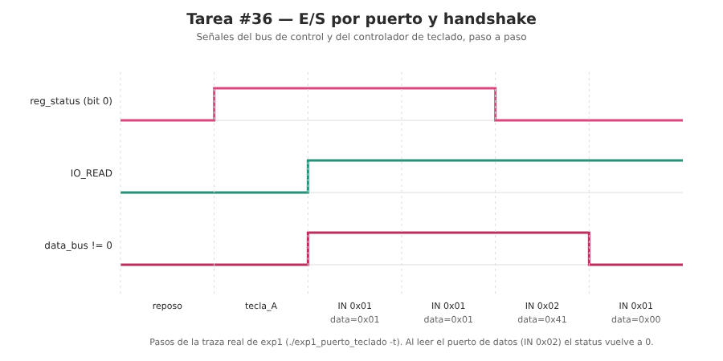
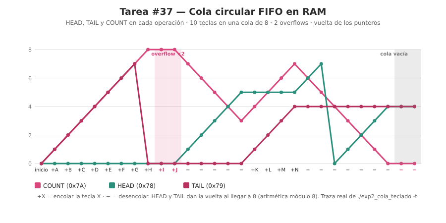
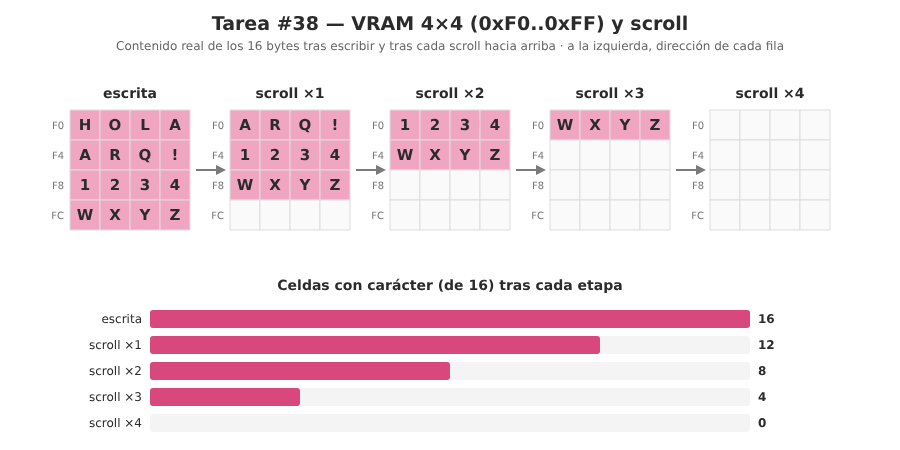
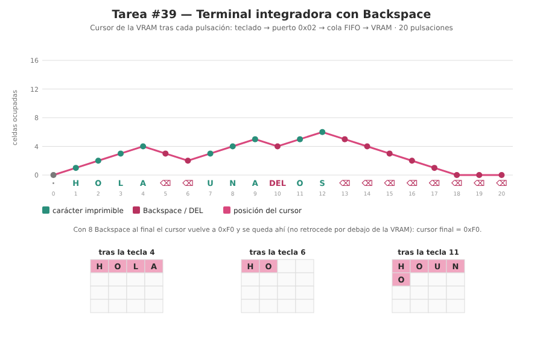

# Clase 14 — E/S por puerto, cola FIFO de teclado y memoria de video (VRAM) en ANSI C

**Fecha:** 26/10/2026
**Tareas:**

- [#36 — Experiment 1: direct keyboard read through an I/O port (`IO_READ` + automatic handshake)](https://github.com/Luugallego17/Arquitectura-De-Computadoras-/issues/36)
- [#37 — Experiment 2: 8-byte circular FIFO keyboard queue in RAM with Buffer Overflow detection](https://github.com/Luugallego17/Arquitectura-De-Computadoras-/issues/37)
- [#38 — Experiment 3: 4x4 video memory (VRAM 0xF0..0xFF) with write, read and vertical scroll](https://github.com/Luugallego17/Arquitectura-De-Computadoras-/issues/38)
- [#39 — Integrating challenge: terminal with Backspace, plus the Clase_14 README and the root README](https://github.com/Luugallego17/Arquitectura-De-Computadoras-/issues/39)

Práctico *Guía de Laboratorio ANSI C: E/S por Puerto, Cola FIFO y VRAM*:

> Implementar en ANSI C (C89/C99) con GCC los controladores de un computador
> simulado: **(exp1)** E/S aislada con la señal `IO_READ` y el handshake de
> limpieza automática del puerto, **(exp2)** una cola circular FIFO de 8 bytes
> dentro del arreglo de RAM con punteros `KB_HEAD`, `KB_TAIL` y `KB_COUNT` y
> detección de *Buffer Overflow*, **(exp3)** la VRAM de 4×4 caracteres con
> escritura, lectura y *scroll* vertical, y **(terminal)** una terminal que
> une las tres piezas y soporta la tecla de retroceso (Backspace).

## Contenido de la carpeta

| Archivo | Descripción |
|---------|-------------|
| [`exp1_puerto_teclado.c`](exp1_puerto_teclado.c) | Tarea #36. `cpu_instruccion_in()` pone la dirección en el bus, activa `IO_READ` y el controlador responde; leer el puerto de datos pone el status en 0. 6 pruebas con 8 verificaciones. |
| [`exp2_cola_teclado.c`](exp2_cola_teclado.c) | Tarea #37. `cola_teclado_encolar()` / `desencolar()` operan **solo** sobre `g_ram[0x70..0x7A]` con aritmética módulo 8. 6 pruebas con 10 verificaciones. |
| [`exp3_vram_monitor.c`](exp3_vram_monitor.c) | Tarea #38. `vram_escribir()`, `vram_leer()` y `vram_scroll_arriba()` sobre `0xF0..0xFF`, con rechazo de coordenadas fuera de rango. 6 pruebas con 13 verificaciones. |
| [`reto_integrador_terminal.c`](reto_integrador_terminal.c) | Tarea #39. Teclado → puerto 0x02 → cola FIFO → VRAM, con Backspace (`0x08`) y DEL (`0x7F`). 8 pruebas con 14 verificaciones; modo `-i` interactivo. |
| [`demo_cursor_uint8.c`](demo_cursor_uint8.c) | Reproduce un fallo del código literal del enunciado (cursor `uint8_t`); ver [Límites](#límites-del-código-del-enunciado). |
| [`ejecutar_pruebas.sh`](ejecutar_pruebas.sh) | Compila, ejecuta y regenera **todas** las evidencias de `evidencias/` (`bash ejecutar_pruebas.sh`). |
| [`graficos/`](graficos/) | `generar_graficos.py` (gráficos a partir de las trazas reales) y `generar_capturas.py` (capturas de terminal de las evidencias). |
| [`evidencias/`](evidencias/) | Salidas originales sin editar y capturas. |

## Mapa de memoria y puertos del sistema

| Dirección | Recurso | Función |
|-----------|---------|---------|
| `0x00 – 0x5F` | RAM de código | Instrucciones ejecutables de la CPU. |
| `0x70 – 0x77` | Cola de teclado | Buffer circular FIFO en RAM (8 bytes). |
| `0x78`, `0x79`, `0x7A` | Punteros de la cola | `KB_HEAD`, `KB_TAIL`, `KB_COUNT`. |
| `0xF0 – 0xFF` | VRAM | Matriz de pantalla de 4×4 (16 caracteres). La celda `(fila, col)` está en `0xF0 + fila·4 + col`. |
| Puerto `0x01` | Status del teclado | Bit 0 = tecla lista. |
| Puerto `0x02` | Data del teclado | ASCII de la tecla; **leerlo limpia el status**. |

## Conceptos

- **E/S aislada (*port-mapped I/O*).** Los dispositivos tienen un espacio de
  direcciones propio, distinto de la RAM, y se accede con instrucciones
  especiales (`IN`/`OUT`). El **Bus de Control** distingue los dos mundos:
  `IO_READ` activa el espacio de puertos y `MEM_READ` el de memoria. En
  `exp1` `mem_read` se mantiene en `false` durante cada `IN`.
- **Handshake automático.** El controlador baja el bit de status en el mismo
  ciclo en que entrega el dato. Así la CPU no necesita una instrucción
  aparte para "confirmar" la lectura y no puede leer dos veces la misma
  tecla. Leer el *status* (puerto `0x01`) **no** lo limpia: solo lo hace
  leer el *dato* (puerto `0x02`).
- **Sondeo (*polling*).** La CPU repite `IN 0x01` hasta que el bit 0 vale 1 y
  entonces hace `IN 0x02`.
- **Cola circular (*ring buffer*) FIFO.** Un arreglo de tamaño fijo con dos
  índices: `TAIL` donde se escribe y `HEAD` donde se lee. Al llegar al final
  vuelven al inicio con `(i + 1) % 8`, así no hace falta mover datos.
  `COUNT` distingue "vacía" (0) de "llena" (8), porque en ambos casos
  `HEAD == TAIL`.
- **Buffer Overflow.** Encolar con `COUNT == 8` no debe pisar la tecla más
  vieja: se devuelve `false` y la tecla se pierde, pero la RAM no se corrompe.
- **VRAM mapeada en memoria.** Escribir un byte en `0xF0..0xFF` cambia el
  carácter mostrado; el *scroll* copia cada fila sobre la anterior y limpia
  la última con `0x20` (espacio).

## Cómo compilar y ejecutar

```bash
gcc -std=c99 -Wall -Wextra -pedantic exp1_puerto_teclado.c        -o exp1
gcc -std=c99 -Wall -Wextra -pedantic exp2_cola_teclado.c          -o exp2
gcc -std=c99 -Wall -Wextra -pedantic exp3_vram_monitor.c          -o exp3
gcc -std=c99 -Wall -Wextra -pedantic reto_integrador_terminal.c   -o terminal

./exp1 && ./exp2 && ./exp3 && ./terminal      # pruebas automáticas (código de salida 0 si todo pasa)
./terminal -i                                  # terminal interactiva: '<' es Backspace, ENTER envía
./exp2 -t                                      # traza CSV (la usan los gráficos); también en exp1, exp3 y terminal
```

Los cuatro compilan **sin advertencias** con los flags exactos del enunciado.
Todo junto, regenerando las evidencias:

```bash
bash ejecutar_pruebas.sh
python3 graficos/generar_graficos.py && python3 graficos/generar_capturas.py
```

## Resultados medidos

Equipo: Linux 6.18, `gcc 13.3.0`, `valgrind 3.22`. Cada programa imprime
`[OK]`/`[FALLO]` por verificación y termina con código `0` solo si todas pasan.

| Programa | Pruebas | Verificaciones | Resultado | ASan + UBSan | Valgrind | Líneas cubiertas (`gcov`) |
|----------|:---:|:---:|:---:|:---:|:---:|:---:|
| `exp1` | 6 | 8 | ✅ 0 fallos | 0 errores | 0 errores | 85.1 % |
| `exp2` | 6 | 10 | ✅ 0 fallos | 0 errores | 0 errores | 81.0 % |
| `exp3` | 6 | 13 | ✅ 0 fallos | 0 errores | 0 errores | 84.0 % |
| `terminal` | 8 | 14 | ✅ 0 fallos | 0 errores | 0 errores | 84.3 % |

> La cobertura no llega al 100 % porque las líneas sin ejecutar son los modos
> `-t` (traza) e `-i` (interactivo), que no corren en las pruebas automáticas;
> se ejercitan aparte (evidencias `06` y `10`).

### Tarea #36 — E/S por puerto (`exp1`)

Un `IN 0x01` sin tecla devuelve 0; tras `teclado_presionar('A')` devuelve 1
**las veces que se repita**; el primer `IN 0x02` entrega `0x41` y el siguiente
`IN 0x01` devuelve 0:

```
Prueba 4: leer el puerto de datos entrega el ASCII y limpia el status
  IN 0x02 -> dato = 0x41 ('A')
  [OK] dato = 0x41 ('A')
  IN 0x01 -> status = 0
  [OK] status = 0 (handshake automatico)
```



### Tarea #37 — Cola FIFO en RAM (`exp2`)

Se llenan las 8 posiciones, la novena tecla es rechazada y las 8 salen en el
mismo orden. El volcado de la RAM muestra el buffer y los tres punteros:

```
  cola llena
    0x70..0x77 (buffer): 41(A) 42(B) 43(C) 44(D) 45(E) 46(F) 47(G) 48(H)
    HEAD(0x78)=0  TAIL(0x79)=0  COUNT(0x7A)=8
  [OK] encolar con la cola llena devuelve false
```

La prueba 5 fuerza la vuelta circular (`HEAD=5`, `TAIL=4`, `COUNT=7`) y verifica
que el orden se conserva: `6abcdef`. La prueba 6 llena la RAM con `0xEE` y
comprueba que nada fuera de `0x70..0x7A` cambia.



### Tarea #38 — VRAM y scroll (`exp3`)

```
  despues de un scroll          fila 0 = antigua fila 1 (ARQ!)
  +----+                        fila 3 queda en blanco (0x20)
  |ARQ!|  0xF0..0xF3
  |1234|  0xF4..0xF7
  |WXYZ|  0xF8..0xFB
  |    |  0xFC..0xFF
  +----+
```

También se verifica que `(2,3)` está en `0xFB`, que `fila 4` y `columna 4` se
rechazan sin tocar `0xFF` ni `0x00`, y que cuatro scrolls dejan la VRAM vacía.



### Tarea #39 — Terminal con Backspace (reto integrador)

Cada pulsación recorre el camino completo: `teclado_presionar` → `IN 0x01`
(sondeo) → `IN 0x02` → `cola_teclado_encolar` → `cola_teclado_desencolar` →
VRAM. Con `printf 'HOLA<ANOS\nXY<<\n' | ./terminal -i` (donde `<` es Backspace):

```
  |HOLA|   cursor=0xF4      se escribió HOLA
  |HOL |   cursor=0xF3      Backspace borró la A
  |HOLA|   cursor=0xF4      se reescribió la A
  |HOLA|
  |NOSX|   cursor=0xF8      siguen N, O, S (fila 1) y X
  |HOLA|
  |NOS |   cursor=0xF7      dos Backspace borran Y y X
```

(la sesión completa, con la pantalla tras cada tecla, está en la evidencia `06`).

Las 8 pruebas automáticas cubren: escribir, Backspace (`0x08`), DEL (`0x7F`),
Backspace con la pantalla vacía (el cursor no baja de `0xF0`), pantalla llena
(el cursor se detiene en `0x100` y la tecla 17 se descarta), Backspace con la
pantalla llena, caracteres no imprimibles (`0x01`, `0x1B`) ignorados y una
ráfaga de 10 teclas sin procesar que pierde exactamente 2 por *overflow*.



### Evidencias

Las salidas originales están sin editar en [`evidencias/`](evidencias/)
(las genera `ejecutar_pruebas.sh`):

| Archivo | Contenido |
|---------|-----------|
| [`00_entorno.txt`](evidencias/00_entorno.txt) | Kernel, compilador, valgrind y CPU del equipo de prueba. |
| [`01_compilacion.txt`](evidencias/01_compilacion.txt) | Compilación de los cuatro programas con los flags del enunciado, sin advertencias. |
| [`02_exp1_puerto_teclado.txt`](evidencias/02_exp1_puerto_teclado.txt) | Salida completa de `exp1`. |
| [`03_exp2_cola_teclado.txt`](evidencias/03_exp2_cola_teclado.txt) | Salida completa de `exp2` (volcados de la RAM). |
| [`04_exp3_vram_monitor.txt`](evidencias/04_exp3_vram_monitor.txt) | Salida completa de `exp3` (monitor dibujado en cada paso). |
| [`05_reto_integrador_terminal.txt`](evidencias/05_reto_integrador_terminal.txt) | Salida completa de las 8 pruebas de la terminal. |
| [`06_terminal_interactiva.txt`](evidencias/06_terminal_interactiva.txt) | Sesión de `./terminal -i` con Backspace, pantalla tras cada tecla. |
| [`07_fallo_cursor_uint8.txt`](evidencias/07_fallo_cursor_uint8.txt) | Demostración del fallo del cursor `uint8_t` del enunciado. |
| [`08_sanitizers_valgrind.txt`](evidencias/08_sanitizers_valgrind.txt) | AddressSanitizer + UBSan y Valgrind: 0 errores en los cuatro programas. |
| [`09_cobertura_gcov.txt`](evidencias/09_cobertura_gcov.txt) | Cobertura de líneas y ramas de cada programa. |
| [`10_trazas.txt`](evidencias/10_trazas.txt) | Trazas CSV que alimentan los gráficos. |

Capturas de terminal de esas salidas: [`evidencias/capturas/`](evidencias/capturas/).

### Gráficos

| Tarea | Gráfico |
|-------|---------|
| #36 Puerto |  |
| #37 Cola |  |
| #38 VRAM |  |
| #39 Terminal |  |

Se regeneran con `python3 graficos/generar_graficos.py`: compila los programas,
corre cada uno con `-t` y dibuja la traza **real** (ningún valor está escrito a
mano).

## Explicación

1. **Por qué la lectura del dato limpia el status.** Es un handshake de
   "consumo": si el status quedara en 1, la CPU leería la misma tecla dos veces
   en el sondeo siguiente. Leer el puerto `0x01` no cambia nada (prueba 3), de
   modo que se puede consultar tantas veces como se quiera hasta que llegue el
   dato.
2. **Por qué la cola necesita `COUNT`.** Con 8 posiciones y solo `HEAD`/`TAIL`,
   "vacía" y "llena" se verían iguales (`HEAD == TAIL`). `COUNT` los separa y
   además hace trivial detectar el overflow (`count >= 8`). En la gráfica de la
   tarea #37 se ve cómo `TAIL` vuelve a 0 con la octava tecla mientras `COUNT`
   queda en 8.
3. **Por qué el scroll copia de arriba hacia abajo.** Para mover la fila `f+1`
   sobre la `f` hay que recorrer `f = 0, 1, 2` en ese orden; si se hiciera al
   revés se sobrescribiría una fila antes de copiarla. La última fila se
   rellena con `0x20` y no con `0x00` para que el monitor muestre un espacio.
4. **Backspace.** El cursor retrocede una celda y escribe `0x20` en ella
   (borrado visual); si ya está en `0xF0` no hace nada, para no tocar la
   dirección `0xEF`, que no es VRAM.

## Límites del código del enunciado

Al probar aparecieron puntos que conviene dejar escritos. La lógica se mantuvo
**igual a la del enunciado**, salvo el primero, que es un error real:

- **El cursor `uint8_t` no puede detectar "pantalla llena".** En el enunciado,
  `cursor_vram` es de 8 bits y la condición es `cursor_vram <= 0xFF`, que es
  **siempre verdadera**; al incrementar desde `0xFF` el cursor vuelve a `0x00` y
  el carácter 17 se escribiría en la **RAM de código**. `demo_cursor_uint8.c`
  lo reproduce (evidencia `07`: con 19 caracteres, `RAM[0x00..0x02]` pasan a
  `Q`, `R`, `S`) y GCC lo señala con `-Wextra` (`-Wtype-limits`). En
  `reto_integrador_terminal.c` el cursor es `uint16_t`: llega a `0x100` y la
  tecla extra se descarta (prueba 5).
- **La terminal del enunciado no hace *scroll*.** Al llenarse la pantalla las
  teclas se descartan; `vram_scroll_arriba()` existe (exp3) pero no se invoca
  desde la terminal. Se dejó así para no cambiar el comportamiento pedido.
- **Las teclas se pierden si la cola se llena.** Con una ráfaga mayor que 8
  sin atender, `cola_teclado_encolar` devuelve `false` y la tecla se pierde
  (prueba 8); no hay interrupciones ni control de flujo en este modelo.
- **Texto del PDF.** En el PDF aparecen secuencias como `&g;_bus` y `&tecla;`;
  son artefactos del PDF (el código correcto es `&g_bus` y `&tecla`).
- **Un solo archivo por programa.** Para que los comandos de compilación del
  enunciado funcionen tal cual, cada `.c` es independiente y repite las
  piezas que usa (por ejemplo, la cola está en `exp2` y en la terminal).

## Cambios respecto al código del enunciado

- Se completaron las partes que el PDF solo esboza: estructuras `SystemBuses`
  y `TecladoHardware`, `teclado_presionar`, inicialización de la RAM, volcados
  y las pruebas con verificación automática.
- `cursor_vram` pasa de `uint8_t` a `uint16_t` (ver arriba).
- Se agregó el modo `-t` (traza CSV) a cada programa y el modo `-i`
  (interactivo) a la terminal.
