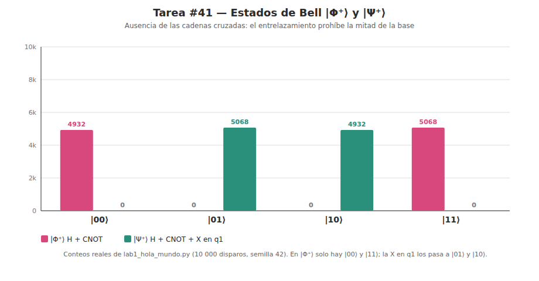
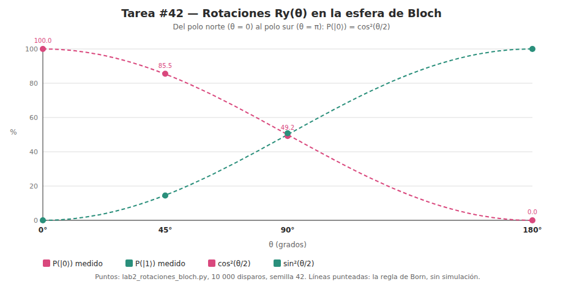
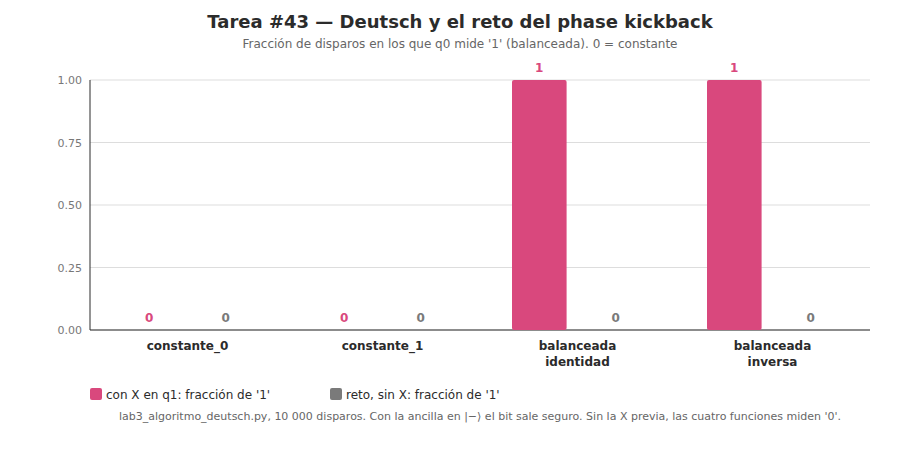
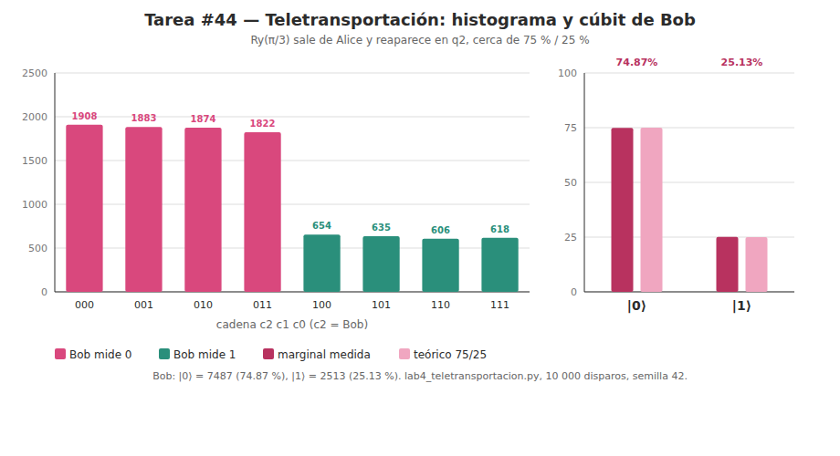

# Clase 15 — Computación cuántica con Qiskit: Bell, Bloch, Deutsch y teletransportación

**Fecha:** 16/11/2026
**Tareas:**

- [#40 — Entorno Qiskit en Ubuntu y verificación de la instalación](https://github.com/Luugallego17/Arquitectura-De-Computadoras-/issues/40)
- [#41 — Práctica 1: Estado de Bell (`lab1_hola_mundo.py`) y reto del estado Ψ⁺](https://github.com/Luugallego17/Arquitectura-De-Computadoras-/issues/41)
- [#42 — Práctica 2: Rotaciones en la esfera de Bloch (`lab2_rotaciones_bloch.py`)](https://github.com/Luugallego17/Arquitectura-De-Computadoras-/issues/42)
- [#43 — Práctica 3: Algoritmo de Deutsch (`lab3_algoritmo_deutsch.py`) y reto del phase kickback](https://github.com/Luugallego17/Arquitectura-De-Computadoras-/issues/43)
- [#44 — Práctica 4: Teletransportación cuántica (`lab4_teletransportacion.py`)](https://github.com/Luugallego17/Arquitectura-De-Computadoras-/issues/44)
- [#45 — Cuestionario, README de Clase_15 y actualización del README raíz](https://github.com/Luugallego17/Arquitectura-De-Computadoras-/issues/45)

Práctico *Guía de Laboratorio: Programación Cuántica con Qiskit en Linux Ubuntu*,
en el marco del curso *Computación cuántica full-stack*:

> Dejar listo un entorno virtual con Qiskit 1.x y Aer, y construir, simular y
> analizar cuatro circuitos: el Estado de Bell, las rotaciones continuas en la
> esfera de Bloch, el algoritmo de Deutsch y la teletransportación cuántica.
> Cada circuito se corre 10 000 veces y se dibuja en ASCII, sin display gráfico.

## Contenido de la carpeta

| Archivo | Descripción |
|---------|-------------|
| [`lab1_hola_mundo.py`](lab1_hola_mundo.py) | Tarea #41. Hadamard en q0 y CNOT hacia q1: el Estado de Bell \|Φ⁺⟩. Con `--psi-plus`, Pauli-X en q1 prepara \|Ψ⁺⟩ (reto práctico 1). |
| [`lab2_rotaciones_bloch.py`](lab2_rotaciones_bloch.py) | Tarea #42. `Ry(θ)` en θ = 0, π/4, π/2 y π, con la probabilidad medida al lado de cos²(θ/2) y sin²(θ/2). |
| [`lab3_algoritmo_deutsch.py`](lab3_algoritmo_deutsch.py) | Tarea #43. Los cuatro oráculos de la guía, en una sola consulta. Al final, el mismo circuito sin la X de la ancilla (reto práctico 2). |
| [`lab4_teletransportacion.py`](lab4_teletransportacion.py) | Tarea #44. Teletransporta `Ry(π/3)\|0⟩` (75 % / 25 %) de Alice (q0) a Bob (q2) y mide el cúbit de Bob. |
| [`requirements.txt`](requirements.txt) | Qiskit 1.4.6, Qiskit Aer 0.17.2, matplotlib 3.11.2 y pylatexenc 2.11. |
| [`ejecutar_pruebas.sh`](ejecutar_pruebas.sh) | Corre los cuatro scripts con el `.venv` y regenera `evidencias/` (`bash ejecutar_pruebas.sh`). |
| [`graficos/`](graficos/) | `generar_graficos.py` dibuja SVG y PNG desde los conteos reales de Aer. `generar_capturas.py` arma las capturas de terminal. |
| [`diapositivas/`](diapositivas/) | `clase15_investigaciones.pptx`: siete diapositivas. La tercera cita investigaciones internacionales, nacionales y locales. `generar_diapositivas.py` las reconstruye. |
| [`evidencias/`](evidencias/) | Salidas originales de esta ejecución y capturas. |

## Conceptos

- **Espacio de Hilbert.** Un cúbit es un vector unitario de ℂ²,
  \|ψ⟩ = α\|0⟩ + β\|1⟩, con \|α\|² + \|β\|² = 1. α y β son amplitudes
  complejas. La regla de Born dice que al medir en la base computacional
  se obtiene 0 con probabilidad \|α\|² y 1 con probabilidad \|β\|², y el
  estado colapsa a ese resultado. Un registro de n cúbits vive en ℂ^(2ⁿ):
  describir 50 cúbits pide del orden de 2⁵⁰ amplitudes.
- **Esfera de Bloch.** Quitando la fase global, todo estado puro de un
  cúbit es \|ψ⟩ = cos(θ/2)\|0⟩ + e^(iφ) sin(θ/2)\|1⟩. θ = 0 es el polo
  norte (\|0⟩), θ = π el polo sur (\|1⟩) y θ = π/2 el ecuador. `Ry(θ)`
  gira en el plano X-Z y deja la fase en cero, así que
  P(\|0⟩) = cos²(θ/2) y P(\|1⟩) = sin²(θ/2). Las compuertas de un cúbit
  son rotaciones de SU(2): conservan la norma y son reversibles.
- **Estado puro y bases insesgadas.** Hadamard sobre \|0⟩ da
  \|+⟩ = (\|0⟩ + \|1⟩)/√2. Medir en Z sale 50/50, y aun así el estado es
  puro: un segundo Hadamard interfiere y devuelve \|0⟩ con certeza. Esa
  complementariedad entre la base Z y la base X es la que usa Deutsch.
- **Entrelazamiento y estados de Bell.** \|Φ⁺⟩ = (\|00⟩ + \|11⟩)/√2 no se
  puede escribir como \|ψₐ⟩ ⊗ \|ψ_b⟩. Medir un cúbit fija el otro. Los
  cuatro estados de Bell son \|Φ⁺⟩, \|Φ⁻⟩, \|Ψ⁺⟩ = (\|01⟩ + \|10⟩)/√2 y
  \|Ψ⁻⟩. Esa correlación no la reproduce ninguna teoría de variables
  ocultas locales (Bell, 1964): la desigualdad CHSH clásica pide S ≤ 2 y
  la mecánica cuántica llega a 2√2.
- **Phase kickback y Deutsch (1985).** El oráculo actúa como
  U_f \|x⟩\|y⟩ = \|x⟩\|y ⊕ f(x)⟩. Con la ancilla en
  \|−⟩ = (\|0⟩ − \|1⟩)/√2 el valor de f no se guarda en el segundo cúbit:
  rebota como fase, U_f \|x⟩\|−⟩ = (−1)^f(x) \|x⟩\|−⟩. Si f es constante,
  q0 vuelve a \|0⟩; si es balanceada, a \|1⟩. Una consulta decide lo que
  en clásico exige evaluar f(0) y f(1).
- **Teletransportación (Bennett et al., 1993).** Alice y Bob comparten
  \|Φ⁺⟩. Alice mide su cúbit desconocido junto con su mitad del par, en
  la base de Bell, y manda dos bits clásicos. Bob aplica X, Z, ambas o
  ninguna. El estado queda en Bob y desaparece de Alice: no se clona
  (teorema de no-clonación, Wootters y Zurek, 1982).
- **Hardware criogénico.** El circuito de Qiskit es la capa de software,
  a ~300 K. Debajo, FPGAs y generadores de onda (AWG/DAC) convierten cada
  compuerta en un pulso de microondas de 4 a 8 GHz. Cables coaxiales
  (CuNi/NbTi) bajan por las etapas del criostato de dilución ³He/⁴He
  (50 K, 4 K, still, 15 mK). En el chip, el cúbit Transmon es un circuito
  superconductor con una unión Josephson: la anarmonicidad separa la
  transición \|0⟩↔\|1⟩ de las siguientes. La lectura es dispersiva; la
  señal sube por un TWPA (15 mK) y un HEMT (4 K) hasta el ADC. Esta
  práctica corre en el simulador ideal Aer, así que no aparecen T₁ ni T₂.

## Investigaciones de referencia

Las diapositivas están en
[`diapositivas/clase15_investigaciones.pptx`](diapositivas/clase15_investigaciones.pptx).
La tercera nombra, en tres columnas, un trabajo internacional, uno nacional
y uno local. Se regeneran con `python3 diapositivas/generar_diapositivas.py`.

- **Internacional.** Son los protocolos que el código de la guía implementa.
  Deutsch (1985), *Proceedings of the Royal Society A*, 400, 97-117, es el
  lab 3. Bennett, Brassard, Crépeau, Jozsa, Peres y Wootters (1993),
  *Physical Review Letters*, 70, 1895-1899, es el lab 4, y el artículo ya
  dice que Bob necesita el mensaje clásico. Bell (1964), *Physics*, 1,
  195-200, y Ekert (1991), *Physical Review Letters*, 67, 661-663, son el
  recurso de \|Φ⁺⟩ y de la criptografía E91. Wootters y Zurek (1982),
  *Nature*, 299, 802-803, es la no-clonación. Koch y otros (2007),
  *Physical Review A*, 76, 042319, es el Transmon del módulo de hardware.
- **Nacional.** Bacarreza, Farnsworth, Makarovskiy, Wallner, Hicks,
  Sempere-Llagostera, Price, Francis-Jones y Clements (2025), *Quantum
  latent distributions in deep generative models*, arXiv:2508.19857.
  Omar Bacarreza es investigador boliviano y primer autor. El procesador
  es fotónico y está en ORCA Computing, en Londres: el paper no se midió
  en una universidad de Bolivia. En mayo de 2026 dio una master class en
  Unifranz; eso es divulgación en el país, no un segundo experimento.
- **Local (La Paz).** Calle García y Rivera Bretel (2018), *Revista
  Boliviana de Física*, 33, 3-12, Instituto de Investigaciones Físicas de
  la UMSA, calle 27 de Cota Cota. Miden con Monte Carlo la eficiencia de
  disparo del arreglo ALPACA, previsto en el cerro Estuquería, junto a
  Chacaltaya. El 16 de agosto de 2019 la UMSA tuvo en el Paraninfo la
  conferencia de Eduardo Sáenz de Cabezón. CIDIMEC, de esta facultad
  (Resolución Rectoral 017/2017), publica cómputo de alto rendimiento y
  co-diseño software-hardware. En La Paz no hay un criostato de cúbits:
  la referencia local es de detectores y de arquitectura de computadoras.

## Cómo crear el .venv y ejecutar

Ubuntu 23.04+ (PEP 668) no deja instalar paquetes con `pip` en el Python
del sistema. El entorno virtual resuelve eso. En esta máquina ya estaban
Python 3.12, pip y `build-essential`; hizo falta instalar `python3.12-venv`
para poder crear el entorno. No se usó `pip install --break-system-packages`.

`pip install qiskit` sin tope resuelve hoy la serie 2.x (la última del
índice es 2.6.2). La guía pide Qiskit 1.x, así que `requirements.txt` fija
1.4.6 y Aer 0.17.2, la última serie de Aer compatible con esa línea.

```bash
cd Clase_15
python3 -m venv .venv
source .venv/bin/activate
pip install --upgrade pip
pip install -r requirements.txt

# El one-liner de la guía
python3 -c "import qiskit, qiskit_aer; print('Qiskit Core:', qiskit.__version__); print('Aer Simulator OK')"

python3 lab1_hola_mundo.py                 # |Φ⁺⟩
python3 lab1_hola_mundo.py --psi-plus      # reto |Ψ⁺⟩
python3 lab2_rotaciones_bloch.py
python3 lab3_algoritmo_deutsch.py
python3 lab4_teletransportacion.py
```

Todo junto, regenerando las salidas de `evidencias/`:

```bash
bash ejecutar_pruebas.sh
python3 graficos/generar_graficos.py && python3 graficos/generar_capturas.py
```

Los gráficos en PNG usan `node` y `playwright` (Chromium, o Chrome si
Chromium no está instalado), igual que en la Clase 14. Los SVG se generan
igual sin eso. `MPLBACKEND=Agg` y `qc.draw(output='text')` evitan el aviso
`FigureCanvasAgg` de un servidor sin X11.

La semilla del simulador es 42 en los cuatro scripts. Volver a ejecutarlos
reproduce estos conteos. Sin semilla, un 50/50 de 10 000 disparos se mueve
unas décimas de punto de una corrida a otra.

## Resultados medidos

Equipo de la corrida guardada en [`evidencias/00_entorno.txt`](evidencias/00_entorno.txt):
Linux 6.12.113+, Python 3.12.3, Intel Xeon. Qiskit 1.4.6 y Aer 0.17.2.
Los cuatro scripts terminan con código 0. Ninguna línea es `[FALLO]`.

| Programa | Disparos | Qué se comprobó | Resultado |
|----------|:---:|:---|:---:|
| `lab1` \|Φ⁺⟩ | 10 000 | solo \|00⟩ y \|11⟩, cerca del 50/50 | ✅ |
| `lab1 --psi-plus` | 10 000 | solo \|01⟩ y \|10⟩, cerca del 50/50 | ✅ |
| `lab2` | 10 000 × 4 | a menos de 2 puntos del teórico | ✅ |
| `lab3` | 10 000 × 4 | constantes en `'0'`, balanceadas en `'1'`, las 10 000 veces | ✅ |
| `lab3` sin la X | 10 000 × 4 | las cuatro funciones miden `'0'` | ✅ |
| `lab4` | 10 000 | Bob a menos de 2 puntos de 75/25 | ✅ |

### Tarea #40 — Entorno

```
$ python3 -c "import qiskit, qiskit_aer; print('Qiskit Core:', qiskit.__version__); print('Aer Simulator OK')"
Qiskit Core: 1.4.6
Aer Simulator OK
```

También quedaron importables `qiskit-aer 0.17.2`, `matplotlib 3.11.2` y
`pylatexenc 2.11`. El directorio `.venv/` está en `.gitignore`.

### Tarea #41 — Estado de Bell y reto Ψ⁺

Hadamard en q0 y CNOT (q0 → q1). De 10 000 disparos:

```
Estado |00⟩: 4932 ocurrencias (49.32%)
Estado |01⟩: 0 ocurrencias (0.00%)
Estado |10⟩: 0 ocurrencias (0.00%)
Estado |11⟩: 5068 ocurrencias (50.68%)
```

\|01⟩ y \|10⟩ salen en cero: si q0 colapsa a 0, q1 también, y al revés.

El reto intercala Pauli-X en q1, después del CNOT. X cambia \|0⟩ por \|1⟩
en ese cúbit, así \|Φ⁺⟩ pasa a \|Ψ⁺⟩ = (\|01⟩ + \|10⟩)/√2. La misma
corrida, con la misma semilla:

```
Estado |00⟩: 0 ocurrencias (0.00%)
Estado |01⟩: 5068 ocurrencias (50.68%)
Estado |10⟩: 4932 ocurrencias (49.32%)
Estado |11⟩: 0 ocurrencias (0.00%)
```



### Tarea #42 — Rotaciones en la esfera de Bloch

`Ry(θ)` desde el polo norte. El teórico lo imprime el propio script
(cos²(θ/2) y sin²(θ/2)); las cuentas son las de Aer.

| Posición | θ | Cuentas \|0⟩ / \|1⟩ | Medido | Teórico |
|----------|:---:|:---:|:---:|:---:|
| Polo norte | 0 | 10000 / 0 | 100.0 % / 0.0 % | 100.0 % / 0.0 % |
| 45° | π/4 | 8555 / 1445 | 85.5 % / 14.4 % | 85.4 % / 14.6 % |
| Ecuador \|+⟩ | π/2 | 4921 / 5079 | 49.2 % / 50.8 % | 50.0 % / 50.0 % |
| Polo sur | π | 0 / 10000 | 0.0 % / 100.0 % | 0.0 % / 100.0 % |

A 45°, cos²(π/8) = (1 + 1/√2)/2 ≈ 0.85355, o sea 8535.5 cuentas de
10 000 (85.4 % al redondear a un decimal, que es lo que imprime el script).
La medida dio 8555 (85.5 %): 19 cuentas por encima, dentro de la fluctuación
de esa probabilidad (desviación típica √(npq) ≈ 35 cuentas).



### Tarea #43 — Deutsch y el reto de la ancilla

Con la X previa, q1 queda en \|−⟩ y una consulta alcanza. Las 10 000
mediciones de cada oráculo cayeron en el mismo bit:

```
Oráculo: constante_0            | Medición q0: '0' -> Función CONSTANTE | 10000/10000
Oráculo: constante_1            | Medición q0: '0' -> Función CONSTANTE | 10000/10000
Oráculo: balanceada_identidad   | Medición q0: '1' -> Función BALANCEADA | 10000/10000
Oráculo: balanceada_inversa     | Medición q0: '1' -> Función BALANCEADA | 10000/10000
```

Sin esa X, la ancilla se queda en \|+⟩. El oráculo ya no pega el signo
(−1)^f(x) y el segundo Hadamard devuelve q0 a \|0⟩ también en las
balanceadas. El script las clasifica, mal, como constantes:

```
Oráculo: constante_0            | Medición q0: '0' -> Función CONSTANTE | 10000/10000
Oráculo: constante_1            | Medición q0: '0' -> Función CONSTANTE | 10000/10000
Oráculo: balanceada_identidad   | Medición q0: '0' -> Función CONSTANTE | 10000/10000
Oráculo: balanceada_inversa     | Medición q0: '0' -> Función CONSTANTE | 10000/10000
```



### Tarea #44 — Teletransportación

`Ry(π/3)` prepara (√3/2)\|0⟩ + (1/2)\|1⟩, o sea 75 % y 25 %. Tras el par
de Bell, la medición de Alice y las correcciones CX/CZ de la guía, el
cúbit q2 de Bob dio:

```
VERIFICACIÓN EN EL CÚBIT DE BOB (q2):
P(|0⟩): 74.87% (Teórico: 75.00%)
P(|1⟩): 25.13% (Teórico: 25.00%)
cuentas q2: |0⟩ = 7487, |1⟩ = 2513
```

La guía muestra un ejemplo 74.98 % / 25.02 %. Esta corrida, con semilla
42, quedó en 74.87 % / 25.13 %: 13 cuentas por debajo de 7500 en el cero.
Los ocho resultados conjuntos (el bit de la izquierda es q2) suman esos
marginales: 1908 + 1883 + 1874 + 1822 = 7487 cuando Bob mide 0, y
654 + 635 + 606 + 618 = 2513 cuando mide 1.



### Tarea #45 — Cuestionario de la guía (sección 8)

1. **¿Por qué Hadamard sobre \|0⟩ da 50 % / 50 % y el estado sigue siendo puro?**
   H\|0⟩ = \|+⟩ = (\|0⟩ + \|1⟩)/√2. Por Born, cada resultado de la base Z
   vale 1/2. El estado es un solo vector de norma 1, así que la matriz
   densidad ρ = \|+⟩⟨+\| cumple tr(ρ²) = 1: es puro. El 50/50 es la
   incertidumbre de medir en la base equivocada (Z es insesgada respecto
   de X), y la fase relativa sigue ahí. Un segundo Hadamard interfiere:
   la rama \|0⟩ suma y la rama \|1⟩ se cancela, y se recupera \|0⟩ con
   probabilidad 1. Una mezcla clásica de 50 % \|0⟩ y 50 % \|1⟩ no haría eso.

2. **En \|Φ⁺⟩ = (\|00⟩ + \|11⟩)/√2, si el primer cúbit mide 1, ¿cuál es la probabilidad de que el segundo colapse a 0?**
   Cero. En el estado no hay amplitud de \|10⟩. Proyectar el primer cúbit
   sobre \|1⟩ deja \|11⟩. La corrida de la tarea #41 lo enseña al revés
   de la estadística: de 10 000 disparos, \|10⟩ y \|01⟩ salieron 0 veces.

3. **Reto práctico 1. ¿Qué Pauli hay que intercalar, y sobre qué cúbit, para obtener \|Ψ⁺⟩ = (\|01⟩ + \|10⟩)/√2?**
   Pauli-X sobre q1, después del CNOT. X\|0⟩ = \|1⟩ y X\|1⟩ = \|0⟩, luego
   (\|00⟩ + \|11⟩)/√2 pasa a (\|01⟩ + \|10⟩)/√2. El modo `--psi-plus` lo
   hace y, en esta corrida, solo aparecieron \|01⟩ (5068, 50.68 %) y
   \|10⟩ (4932, 49.32 %). Una X sobre q0 también sirve, porque
   (\|10⟩ + \|01⟩)/√2 es el mismo estado; el script usa q1, el objetivo
   del CNOT.

4. **Reto práctico 2. ¿Qué pasa en Deutsch si se olvida la X de la ancilla q1 antes del Hadamard?**
   q1 nace en \|0⟩ y el Hadamard lo deja en \|+⟩, no en \|−⟩. Sobre \|+⟩
   el oráculo no hace nada observable: \|0 ⊕ f(x)⟩ + \|1 ⊕ f(x)⟩ = \|0⟩ + \|1⟩
   para cualquier f(x), así que no aparece el factor (−1)^f(x). Sin ese
   phase kickback el segundo Hadamard devuelve q0 a \|0⟩ siempre, y las
   cuatro funciones se leen como constantes. Es lo que midió el script:
   `'0'` en los 10 000 disparos de cada oráculo, incluidas las dos
   balanceadas. La ventaja de una sola consulta se pierde.

5. **¿Por qué la teletransportación no envía información más rápido que la luz?**
   El entrelazamiento correlaciona en el acto, pero Bob, antes de los dos
   bits clásicos, tiene un estado mezclado: sin saber qué corrección
   aplicar, su cúbit no revela el mensaje. Esos dos bits viajan por un
   canal clásico, como mucho a la velocidad de la luz. Además el estado
   de Alice se destruye al medir; el teorema de no-clonación impide que
   el original y la copia existan a la vez. En el circuito de la tarea
   #44 se ve el mismo límite: q2 solo reproduce el 75/25 después de las
   correcciones que dependen de la medición de Alice.

### Evidencias

Las salidas originales están sin editar en [`evidencias/`](evidencias/)
(las genera `ejecutar_pruebas.sh`):

| Archivo | Contenido |
|---------|-----------|
| [`00_entorno.txt`](evidencias/00_entorno.txt) | Kernel, Python, CPU y el one-liner `Qiskit Core: 1.4.6` / `Aer Simulator OK`. |
| [`01_lab1_bell.txt`](evidencias/01_lab1_bell.txt) | \|Φ⁺⟩ y el reto \|Ψ⁺⟩, con el circuito en ASCII. |
| [`02_lab2_bloch.txt`](evidencias/02_lab2_bloch.txt) | Los cuatro ángulos, cuentas, porcentaje medido y teórico. |
| [`03_lab3_deutsch.txt`](evidencias/03_lab3_deutsch.txt) | Los cuatro oráculos y el reto sin la X de la ancilla. |
| [`04_lab4_teletransportacion.txt`](evidencias/04_lab4_teletransportacion.txt) | Circuito de la teletransportación, histograma y 75/25 de Bob. |

Capturas de esas terminales: [`evidencias/capturas/`](evidencias/capturas/).

### Gráficos

| Tarea | Gráfico |
|-------|---------|
| #41 Bell |  |
| #42 Bloch |  |
| #43 Deutsch |  |
| #44 Teletransportación |  |

Se regeneran con `python3 graficos/generar_graficos.py`. El script importa
los laboratorios y dibuja lo que Aer devuelve con la semilla 42. La curva
punteada de la esfera de Bloch es la fórmula, marcada aparte de los puntos
medidos.

## Explicación

1. **Por qué \|Φ⁺⟩ no da \|01⟩ ni \|10⟩.** Hadamard parte q0 en dos ramas
   de igual amplitud y la CNOT copia el bit de control al objetivo. Las
   dos ramas que sobreviven son «los dos en 0» y «los dos en 1». Cada
   cúbit, mirado solo, es 50/50; los dos juntos no pueden discrepar. Por
   eso 4932 y 5068 se reparten entre \|00⟩ y \|11⟩, y las otras dos
   cadenas quedan en 0. Eso es lo que no cabe en un modelo local: el
   resultado de uno determina el del otro sin que haya un mensaje entre
   medias.
2. **Por qué la X del reto cambia el par y no la correlación.** Pauli-X
   en q1 voltea el objetivo en las dos ramas a la vez. Sigue habiendo
   una sola amplitud compartida, ahora entre \|01⟩ y \|10⟩. Las cuentas
   de esta corrida (5068 y 4932) siguen cerca del 50/50, y \|00⟩ y \|11⟩
   desaparecen.
3. **Por qué un ángulo continuo no es un bit.** En θ = 0 y θ = π el
   simulador no tiene nada que sortear: las 10 000 cuentas caen del mismo
   lado. En π/4 la amplitud ya no es mitad y mitad, y las 8555 / 1445
   cuentas siguen a cos²(π/8). El bit clásico no tiene un estado intermedio
   que mida 85 %.
4. **Por qué Deutsch usa la fase y no el valor.** Si la ancilla guarda
   f(x) en el bit, hay que leerla, y leerla destruye la superposición de
   q0. En \|−⟩ las dos ramas de la ancilla ya tienen signo opuesto: sumar
   f(x) módulo 2 cambia ese signo y lo deja escrito en q0. El segundo
   Hadamard convierte el signo relativo en un bit seguro. Quitar la X
   inicial borra el signo opuesto y, con él, la diferencia entre constante
   y balanceada. Las 10 000 mediciones en `'0'` del reto son esa identidad.
5. **Por qué Bob recupera el 75/25.** El par compartido más la medición
   de Bell dejan a Bob a una Pauli de distancia del estado original. Las
   correcciones de la guía (CX controlado por q1 y CZ controlado por q0,
   ya colapsados) aplican esa Pauli. Lo que llega a q2 es la amplitud,
   no una copia clásica de un bit: 7487 y 2513 frente a 7500 y 2500.

## Límites del código del enunciado

- **El simulador es ideal.** Aer, sin modelo de ruido, da exactamente 0
  en las cadenas prohibidas del Estado de Bell. En el Transmon del curso
  (15 mK, T₁ de cientos de microsegundos, lectura dispersiva) esas cadenas
  saldrían alguna vez por decoherencia y por error de medida. Esta entrega
  no simula ese ruido: la guía pide el circuito lógico.
- **La corrección de Bob no está escrita como compuerta clásica.** La guía
  mide q0 y q1 y después pone `qc.cx(1, 2)` y `qc.cz(0, 2)`. No usa
  `c_if`. Funciona porque, tras medir, el cúbit queda en el estado del
  bit leído y el control cuántico hace lo mismo que un X o un Z
  condicionado. Se respetó ese código. El orden de la cadena de Aer pone
  el bit de mayor índice a la izquierda, y por eso el carácter 0 es q2.
- **Deutsch en la guía usa 1 000 disparos** y el ejemplo de Bell de la
  diapositiva (5014 / 4986, y 74.98 % / 25.02 % en Bob) es una corrida
  distinta de la de esta semilla. Esos números no son los de esta carpeta.
- **El dibujo ASCII de Qiskit 1.4 y Aer avisan** que `Instruction.condition`
  está en desuso desde Qiskit 1.3. El aviso sale de la biblioteca, no del
  circuito, y no cambia los conteos.

## Cambios respecto al código del enunciado

- Los cuatro scripts llevan los comentarios de la explicación línea por
  línea de la guía y dibujan el circuito con `draw(output='text')`.
  `lab2` y `lab4` también lo imprimen: la guía solo lo muestra en la
  práctica 1, y la tarea #44 lo pide para la teletransportación.
- `AerSimulator(seed_simulator=42)` fija los conteos para que
  `ejecutar_pruebas.sh` y los gráficos coincidan. La guía no fija semilla.
- Cada script lista también las cadenas de cero cuentas y cierra con
  `[OK]` o `[FALLO]`. Si el resultado se aleja de lo que pide la guía
  (más de 2 puntos en Bloch o en Bob, o un bit equivocado en Deutsch),
  el proceso termina con código 1.
- `lab1_hola_mundo.py --psi-plus` resuelve el reto \|Ψ⁺⟩. `lab3` ejecuta
  a continuación los cuatro oráculos sin la X de la ancilla.
- Deutsch corre 10 000 disparos, como el resto del laboratorio. La guía
  pone 1 000. El bit no cambia: en los cuatro oráculos correctos las
  10 000 mediciones coinciden.
- `requirements.txt` ata Qiskit a 1.4.6 y Aer a 0.17.2. Un `pip install
  qiskit` suelto, a la fecha de la práctica, instala 2.x.
- Los avisos `DeprecationWarning` de Qiskit 1.4 se filtran para que la
  terminal quede como la de la guía. `MPLBACKEND=Agg` evita el aviso de
  matplotlib en un servidor sin pantalla.
- Los gráficos se arman en SVG, como en la Clase 14, a partir de una
  ejecución real de cada script. matplotlib y pylatexenc se instalan
  porque la guía los pide; el laboratorio no abre una ventana.
